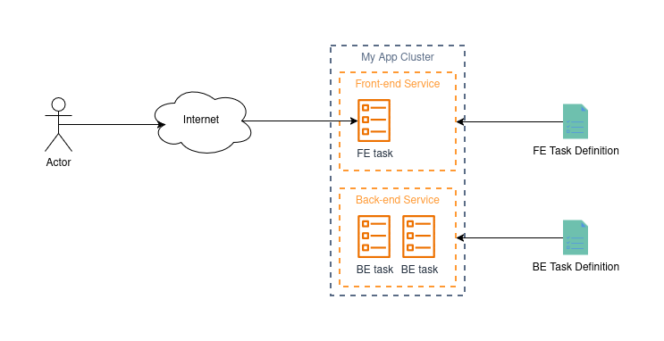
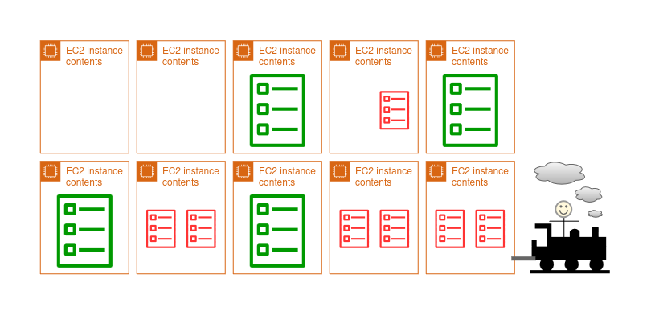
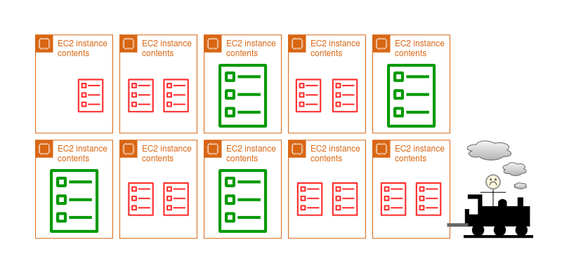
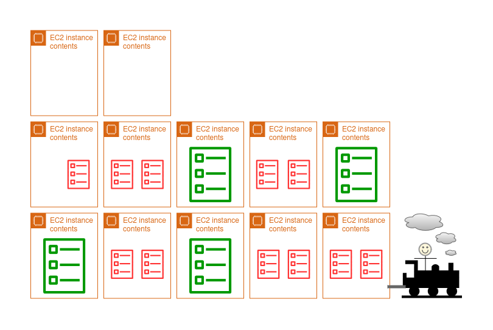
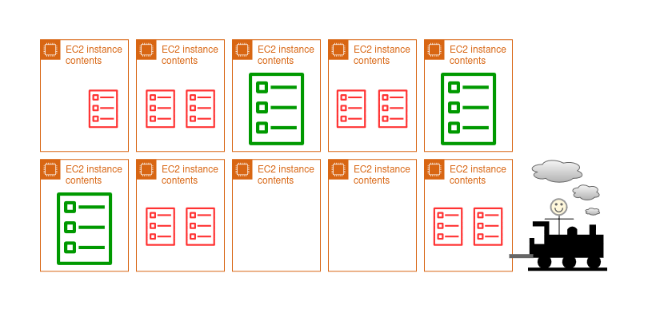
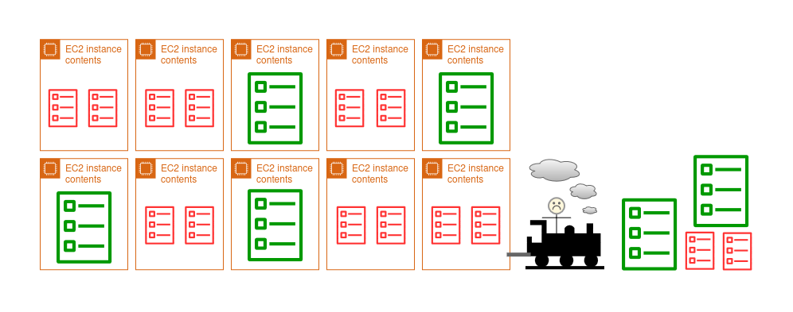

# A Short Preface

A lot of what I enjoy working on is something that runs without much intervention. Something that completes a repeatable task without any manual input from a human. Take for example, the time where I often had to manually deploy a system at work by shelling-into an EC2 instance, and later I had worked out a way to deploy it automatically after a PR merge. This I saw as my goal as a software engineer - find solutions to repeatable problems.

But some of these problems are far more rare than others. Consider parts of your codebase that go untouched for eons until something breaks on a layer deep enough. Think about that Nginx instance that sits between the LB and your app on a unix socket. Think about the authentication backend in your Django app. These are rare problem areas that seem to often be solved once, then left alone for a long time, and very rarely we work on them or improve them because they are already good enough. These sorts of problems are what I enjoy. They provide a necessary, difficult challenge. Like where an answer is hidden deep within one particular interpretation of the AWS documentation, and there are no Medium posts or GitHub issues that you can find about it. As if you are the only one with this problem in the entire world.

Problems like these are ones that I worry are going unspoken or undocumented online, yet they are so valuable in what they can teach. So I'd like to share an accumulation of some of this knowledge from the time I've been spending building software systems.

In this article, I will be taking you through some various types of deployment strategies that I've used in my career and personal projects simply because I enjoy talking about it. These concepts clog up my brain so I love giving myself the opportunity to dump it into a blog or a work-book.

# The VPS (or home linux box)

I've made plenty of systems that I've wanted to share with others. Whether it be a Minecraft server, a website, a prototype, chat, tunnels, sockets, or anything, they've all required a machine with access to the public internet, and also the ability to open ports. This is what I think is the simplest form of deployment - you literally just run it on the host machine in a cloud environment or behind a NAT on a home network. 

It doesn't have to be pretty. Some of my first apps were systemd units that spun-up a Flask app. Others were frameworks that exposed a unix socket that was proxied through nginx to the public internet via a virtual host. The point of this section is to go into deep details about the 'bare app' and how it interacts with a multi-tenant host system - and also to reminisce in the beauty of such in the days of a handful of users, and often in situations where we could not isolate apps onto individual hosts!

Before I learned docker (this is probably around my time in, and a little after, university), I had already learned that user isolation was the biggest advantage that I had for operating software that could get breached. Whenever I started hosting a new project, I would set up a new user account on my linux host, and remove its sudo privileges. Then I would drop all the build files into the user home directory, and then run `screen` so that I can launch the server process without it terminating when I terminate my SSH session. If the project demanded a degree of seriousness, then I'd launch it with a systemd unit instead. Once I picked up docker, I simply started using docker compose to run my application images.

On my machine, I'd have a single nginx instance running on the bare metal. Then whenever I would want a new project, I would set it up with a static docker networking configuration and tell nginx, via a config file, to route all HTTP traffic to that docker container. Another important thing to note is the `Host` header handling behaviour for nginx. In order to manage multiple applications running on a single host, you would typically distinguish them as a "virtual host" by using the `server_name` directive. Here's a snippet of the config from one of my old projects:

```
    ...
    server_name lastfmwall.deltadelta.dev;

    location / {
        proxy_pass http://localhost:8784;
        proxy_set_header Host $host;
        proxy_set_header X-Real-IP $remote_addr;
        proxy_set_header X-Forwarded-For $proxy_add_x_forwarded_for;
        proxy_set_header X-Forwarded-Proto $scheme;

        proxy_connect_timeout 30s;
        proxy_send_timeout 30s;
        proxy_read_timeout 30s;
    }
    ...
```

So basically, when nginx sees the `Host` header from the browser is set to `lastfmwall.deltadelta.dev`, it will pull up this configuration and then follow the directives in this file. To get this config working, the tradition is to create the config in `/etc/nginx/sites-available/`, then soft-link it to `/etc/nginx/sites-enabled/`. Then to check if everything is okay, run `nginx -t` as root, and then restart the nginx service (yes, this would mean a very slight blip in downtime. But I didn't have any serious users to make angry!). After this, I would then set up an SSL configuration using `certbot` which would set up a free SSL certificate for me and alter the nginx config to redirect HTTP to HTTPS.

An advantage of this approach is that the firewall rules for this host machine are simple: Just open ports 80 and 443!

As you can see, this setup is tedious already, but it gets worse - we haven't even talked about deploying new versions of the project!

If you have some changes you need to push, often you would have to shell-into the instance, then log into the user account, then pull the new changes, kill the server, and then bring it back up. Docker makes this much easier - especially with `compose` - but it is functionally the same outcome. This, of course, means more downtime!

I'm sure that I could have automated this with something like Ansible or cron, but the stakes just weren't high enough, and also I didn't really update my apps that often. Additionally, letting CI somehow make changes to a persistent VPS instance seemed quite... quixotic...

I hope you can see a lot of problems with this approach. Namely:
- Downtime on every deploy
- Single-instance (zero scalability)
- Difficult to continuously deploy
- Mental load of remembering all the different software and how to deploy it

But none of this really matters. I'm able to host things for my friends, and set up self-hosted services for myself on my own hardware sitting in my room. Apart from electricity, this is free, and it also gets you to understand the plumbing of any software you are using, or might build, or deploy later on in your career.

# AWS ECS + Fargate

One thing that gets me going is operating heavy machinery (although not the type of machinery you'd typically think of). I've often drooled at pictures of Cyclotrons, Quantum computers, Nuclear reactor cores, etc and said "wow, imagine working on one of those things!". These are truly remarkable machines of our time simply because of their rarity, and the precision necessary to operate and maintain these things. A similar story goes for AWS services, except you can't really see them (unless you consider the countless server racks in datacenters). Hopefully these upcoming sections will help you see some of the beauty I see in my mind.

AWS Elastic Container Service (ECS) is the service that is responsible for running and orchestrating "tasks". These tasks can be considered as an isolated, and infinitely reproducible instance of your application. The 'task definition' is sorta like a `docker compose` configuration. It is the document which defines a lot of different parameters, but most importantly:
- The docker images to run
- The computer resources that each container needs to run
- The environment variables that each container requires
- The networking between containers
- Which containers are critical (mark the task as unhealthy, and terminate it if exited) and what dependencies they have between them

In ECS, a full application is considered a "cluster". The cluster contains services that make up the application (for example, a front-end service and a back-end service), and each service contains a set of tasks. It looks a bit like this:


Now we haven't even talked about where this code is running yet. Is it on a server? What kind? What OS is it running? Can you shell into it? - For the purposes of commercial software, most of the time, these questions are irrelevant - you simply need the code to run and be reachable. So that's kinda what fargate does.

Fargate is what I would describe as a VPS where you only have access to the containers that are running on it. It's kinda like a glorified "Docker compose as a service". Instead of asking what type of EC2 instance you want, you can just say "I want to launch 12 new tasks. Each require 1 CPU and 2GB RAM.", and you'll get exactly 12 new tasks (docker containers) launched all with machines matching those requirements you placed in the task definition!

We'll talk about auto-scaling soon, but for now, let's just imagine that we specifically 'desire' (you'll see this term prominently in ECS) two tasks for BE and one for FE. When we do this, we will (eventually) have a fargate instance assigned to each task with the specs defined in the task definition. AWS will manage the OS, OS updates, security patches, the docker runtime, networking, and anything else involved in providing this "docker compose as a service". So naturally, you can't shell into the OS, but you can shell-into one of the containers in your running task (like running `docker exec -it`). 

> This particular separation of concerns is something you'll commonly see with AWS services, and I think it's important to point out this subtlety because it might help you to shape your own understanding of other services or issues you come across. When we launch a task on AWS Fargate, AWS will handle the bare metal that the machine is running on, turning it on, shutting it down, making sure the RAM works and the disks aren't faulty. They also look after the OS running on the machine that hosts your docker containers along with the container runtime too. You'll see examples of this responsibility if you have long-running Fargate tasks, that is, you may see a notification from AWS telling you that the Fargate instances need to be re-provisioned so that you get access to platform updates. On the other side of the fence, you, however, are responsible for your application, making sure it can run on the instances specified, and that the application serves your customers well. Although it seems blatantly obvious, what you pay for at AWS is the ability to focus more on what's important to the business, and less about micro-managing cloud infrastructure.

So now we have a running application split into the FE service (that serves statefully generated pages for the users), and a BE service (which executes long-running asynchronous jobs). So now, how do we let users access it?

As you might find with these cloud providers, making things public is not exactly the easiest thing to do. Since we are going to talk about a better way to do this a bit later, I'll keep this brief. This is how you would make this FE service public given only a single instance running at any time:
1. In your VPC settings, set up a public subnet.
2. Configure any NAT or other settings to get an IP address.
3. Configure the ENI of the FE task to use a public IP address in that subnet.
4. Then the easiest way to enable SSL is to probably set up a CloudFront distribution with a certificate from ACM, but let's just pretend we don't want that right now and we just want to directly access the instance.

Quite messy! It still doesn't solve the scalability issue, but that's not the worst bit, deployments will still cause an outage! - And additionally, as a consequence of the product, fargate instances will need to be periodically replaced in order to deliver the newest updates to the platform they run on. So your application might just go down every now and then for an automatic update (unless you deploy quite frequently).

The way that ECS performs deployments by default is to first attempt a warm shutdown of any instances and replace them immediately. You may hear this referred to as a "rolling update". When you trigger a new deployment, usually after updating the task definition, it will start culling the existing tasks and replacing them with new ones based on the new task definition. This is not ideal for an application service that requires 100% availability because there's a chance that the new task(s) are not up and serving traffic by the time the old ones have been killed, thus resulting in a HTTP 504.

> Although there are a couple reasons I can think of for this behaviour, I think the most obvious one is due to the application cold start. As far as I remember, the behaviour of ECS in updating a task definition is to simultaneously issue a termination signal to the existing instances while requesting new replacements. Let's say for a moment that it takes 3 minutes (*actually an unsurprising figure*) for your application to reach a state where it can serve requests, and only 10 seconds to shut down. ECS will have killed all available instances while provisioning new ones, and you have a 2-minute and 50s gap where requests may come through, but they can't be served.

But at least the deployment process is straightforward, all you need to do is publish a new task definition, then instruct ECS to update the service with the new task definition, and it will trigger a new deployment. To be a bit more specific, ideally all that you should be changing in the task definition is just the docker image SHAs or version numbers, and on rare occasion, the environment variables for each container. One way you can automate this is by setting up OIDC in IAM so that the CI pipeline you have can assume a role that has access to ECS/ECR and then perform the necessary actions.

Better, but still very rudimentary. Here's what it looks like now:



# AWS ECS + Fargate + ALB

Now we are going to talk about some scalability!

The next problem we are going to try and solve is: **How can we make it so that the application will work under the load of 1 user, and also 1 million users?**

Let's start with load. What happens when we get 1 million users trying to access our application? This would mean 1 million web browsers, and **at least** 1 million ([mostly](https://en.wikipedia.org/wiki/QUIC)) TCP connections. This would probably make our server really slow, especially if we are using a fairly conservative amount of resources (eg, 2 CPU cores and 4GB of RAM), since we would somehow need to process more than 1 million operations in a reasonable time.

> There are also some OS-level considerations that help illustrate the need for a bit more sophistication. Here's a hypothetical for you: 
> 
> Let's say that we can do this, and we get 1 million users every minute, but you can only process 2 connections at a time. On most linux kernels, there is a [default limit of 4096 connections in the socket queue](https://docs.kernel.org/networking/ip-sysctl.html#tcp-variables). Even if we can tweak this limit to be its theoretical maximum, we would need some way to store all of the file descriptors for the sockets, and data buffers for all of those queued connections. This could exhaust CPU and RAM by simply having to hang on to all of those connections, and also managing the overhead of organising them all.

So why don't we just add more FE tasks? Sure that would give us more instances to distribute the load over, but how do we actually get the load over to them if the DNS record we have for my-app.com points to only a single, public IP address? This is where the Application Load-Balancer (ALB) becomes useful!

Do you remember our Nginx reverse proxy from earlier? Instead of having this proxy on the same machine as the application, we can stick it on a different one, and so long as the application is reachable by Nginx, it will serve the application like normal. Now imagine if Nginx can pick from multiple possible IP addresses and round-robin proxy them for each connection. This is basically how a load balancer works.

AWS have their own solution to this problem which allows you to create your own application load balancer (you can find this product in the EC2 console). After the client connects to it from the internet, the ALB will then select an instance in a 'target group' to assign the connection to. Once chosen, the ALB will then establish a connection with the instance and forward the socket data from the client into the new connection. Then the instance will handle all of the processing from there and you can build your application just the same as if you are receiving a request from the client directly.

So now our architecture looks a bit like this:


Now hypothetically, if each FE task can handle 1000 requests per second, then two of them would serve 2000 requests per second, and the ALB lets us take advantage of this. This is what people talk about when referring to 'Horizontal Scaling'.

However, there's a bit of a problem with this: What about during the night when we get literally 0 traffic? This is a bit of a waste, right? - Very true, and we'll solve this one in the following chapter.

I would also like to point out that we have not yet resolved the deployment downtime issues either! ECS will still perform a rolling deployment which may mean that there are no new instances ready by the time the old ones are terminated.

So it seems we still have some work to do...

# AWS ECS + Fargate + ALB + Blue/Green Deployments

So next up, let's solve the problem of downtime during deployments. 

Forgetting about any infrastructure for a moment, let's think about how we'd do this for our app on the linux VPS we talked about earlier. Let's accept that this VPS you have contains some mission-critical software. That means you can't have any downtime when pushing updates. So how could we roll-out our next software update?

Our VPS is the only instance that exists, and we point everyone to it using a DNS record for `my-app.com`. So, naturally, we have the option to alter the A-record with a different IPv4 address. What we can do is set up a new machine with the updated copy of the software, but with a different, public IPv4. We then do whatever Nginx and networking setup we need, and it's ready to go. Then all we need to do is update the A-record at the DNS, and slowly, you will find that *most* of your traffic will hop over to the new server upon the next time they resolve the domain name. This also gives you an option to roll-back if things turn sour for whatever reason. Once you are confident that there are no more clients connecting to your old server, and the new one is operating just fine, you can tear down the old app and server.

Although this is a very crude way of doing things, and I personally wouldn't do this myself, it helps to illustrate what I'm about to explain if you have never had to perform a deployment of a fleet of servers before.

You can imagine the ALB in this scenario as playing a similar role as the DNS server in our above example. Given the wondrous advancements and ubiquity of [SDN](https://en.wikipedia.org/wiki/Software-defined_networking), we can instruct our ALB to re-route traffic without bringing the service down (or changing our DNS records). This means that the ALB can still accept and forward connections, but all new connections will follow a different set of rules.

On our ECS side, all we need to do is bring up a new set of tasks that contain the updated docker images we pushed, then somehow connect them to the ALB. These new tasks are assigned to a separate target group and given a little bit of time to start-up before production traffic is re-routed to them.

So now our architecture looks a little bit like this:


In the diagram, I represent the priority ALB rule to the blue group as a solid line, and the ALB rule that is lower priority to the green group as a dotted line since there is no traffic yet. The reason why the green group doesn't get any traffic is because the rules are identical in every aspect apart from their priority and destination. Ie, "Route all HTTP traffic where the `Host` header is `my-app.com` to target group X". Hence as a lower priority rule, the green one will never get fired.

This is great! Now all we have to do is increase the priority of the green rule and then we have successfully deployed the new app version!

Although this is pretty much complete, there are a few nuances that I think are important to understand:

### What happens to all of the old connections to the old target group?

In short, these connections remain open until they either complete, or are forced to close by ECS.

AWS documents their [ECS task lifecycle](https://aws.amazon.com/blogs/containers/graceful-shutdowns-with-ecs/) which shows you how this process happens. But in a nutshell:
1. A task is stopped in AWS (ie, when our blue group has been terminated)
2. ECS will send a SIGTERM to the container(s) on your task
3. If the application process has not ended before the time-out, ECS will send a SIGKILL to your container to end it forcefully.

So theoretically, there are a few levers you can pull if you need to ensure that connections to your application are closed gracefully:
1. Handle SIGTERM in your application so that you stop accepting connections, and also do not terminate the app until all of the current connections have been closed.
2. Tweak the ECS task timeout to suit your needs for waiting for long-running connections.
3. Implement an application-layer timeout that applies to all endpoints so that it forces you to build an app that is robust to these deployments.
4. Tweak the connection timeout parameter on the ALB to force connections to close if there hasn't been any data on the wire for a certain amount of time.

### How can we automate this?

The above only mentioned the process without actually any infrastructure backing it. AWS does provide a service called CodeDeploy which will handle everything for you. I'm going to keep my explanation brief because it's basically a highly-configurable software pipeline/workflow, so here's the [documentation that AWS provides](https://docs.aws.amazon.com/AmazonECS/latest/developerguide/deployment-type-bluegreen.html) if you need the details. For context, here we are using the "All at once" deployment strategy.

The general way that the 'All at Once' CodeDeploy pipeline works is as follows:
1. Firstly, you need to upload your application docker images and then publish a new task definition (but don't deploy it).
2. Given you've already set up your CodeDeploy application config with all the parameters of your cluster, you will then need to create a new deployment and specify the new task definition.
3. CodeDeploy will then start initialising new ECS tasks and assign them to the other target group in your AWS environment.
4. If set, CodeDeploy will wait for your instances to "warm up".
5. CodeDeploy will then alter the ALB priority to switch the traffic over to the new group.
6. Finally, it will de-provision the instances from the old target group.

# AWS ECS + Fargate + ALB + Blue/Green Deployments + Auto-scaling Policy

So we've solved containerisation, we no longer need to worry about downtime during deployments, and we have a way to scale to serve as many users as we need to. Our last problem is to figure out how we can scale-down our services when people aren't really using them.

Let me take you away from computer engineering for a moment.

As of writing this, I live in Sydney Australia. My closest train station is a part of the [Sydney Metro](https://en.wikipedia.org/wiki/Sydney_Metro) (no, not Sydney Trains!). During peak-hour, there is a train every 4 minutes - and rightly so, as usually it is packed like a sardine tin! If you read the Wikipedia page, you will find that off-peak, it usually runs every 5-10 minutes. But why? To continue playing the devil's advocate I would claim that these are autonomous trains which means we don't need a person manning each one. So shouldn't we just run them once every 4 minutes 24/7 for the sake of the experience? That would of course be a financial catastrophe for the whole project. The train cars need electricity to operate, and each drive causes them to wear out certain components so we need mechanics all the time to be available to fix them, and a constant supply of imported parts. So a more realistic approach for operating this train network would be to sacrifice a bit of service provisioning for some cost savings. It's a reasonable trade-off to keep the service alive for everyone to use no matter whether it's on or off peak.

Same goes for our little app, we shouldn't be running 100 instances during the night where we get a trickle of internet traffic. We'd send ourselves broke quite quickly! 

This is where auto-scaling becomes useful.

The basic principle is:
- There is some metric which will tell you when you need **more** instances.
- There is some metric which will tell you when you need **less** instances.
- Given enough time breaching either metric, we should scale-up or scale-down our instances.

Figuring out the rules for scaling up and down are unique to each application. Each product has its own behaviours, quirks, intended use-cases, and load patterns, so it's important to consider some things before you choose the scaling rules to enforce:
- Is your load very spiky? Do vast amounts of people visit your app at random intervals? - If so, you may want to consider an aggressive scaling policy that scales-up at the slightest sniff of increased traffic, and scales down just as quickly.
- Do people have long-running sessions with your app? - If so, you may want to consider a gentle scale-down policy in case clients still need to fetch small things throughout the day.
- Does your app take a very long time to start up? - If so, you may want to implement some sort of predictive scaling to avoid getting caught being unprovisioned during a burst of traffic.
- Does your app work across a single time-zone? - If so, you might want to set a schedule for scaling.
- Is latency and availability important even during periods of low usage? - If so, you may want to set the minimum instances to a higher amount.

For the case of our app, we are just going to keep things simple and scale based on overall CPU usage from all of our instances. What you will need is something like this:
- In CloudWatch, two metric alarms per service - one for "CPU usage is too high" and another for "CPU usage is too low".
- In ECS, set up a scaling policy for our two services based on these alarms. This includes a minimum and maximum scaling value among other settings as well.

So in reality, it will go something like this:
- When the CPU usage of our service goes above 50% for longer than 30s, we will scale up to maximum.
- When the CPU usage drops below 25% for longer than 15min, then we will start scaling-down one instance at a time.

But what does the auto-scaling policy actually do to alter the amount of instances in service? - It's quite simple, it just alters the number of desired tasks in the ECS service, just like we demonstrated in one of the prior chapters when we wanted to increase our capacity manually.

# Wrapping up

So that's everything sorted. Our whole pipeline looks like this now:
1. Code changes are made and merged into main
2. Our CI/CD pipeline will assume a special IAM role that allows it to push to ECR, update the ECS service for the BE, and launch a CodeDeploy run for the FE service
3. Once our new docker image hits ECR, we will generate a new task definition for the FE and BE services and push them to ECS
4. The BE service will deploy automatically with a rolling update via ECS (remember, it's just async tasks, so we don't need a blue/green deployment)
5. We then trigger a CodeDeploy deployment for the FE service that performs an "All at once" deployment using our green and blue target groups
6. Once complete, CodeDeploy will switch over the rules in the ALB and all users will be running the new app
7. During the night, our FE tasks will scale down to 3 tasks at a minimum, and during the day, up to 16

Not a single person needs to touch any of the processes involved here. All we had to do was spend some time setting the machinery up, and now we have our very own fully autonomous deployment pipeline!

# But what if I can't use Fargate?

All of the above explanation is done with AWS fargate. If you haven't used it already, and your workload can support it, I highly recommend you ditch EC2 instances in favour of ARM-based fargate instances (they are the cheapest for I/O heavy workloads like an API). But if your workload must work with a real instance, there's still a solution for you, and managing an EC2 instance fleet is one of the most interesting things I've had to do in my career. Unfortunately, I worry that this may slowly disappear in favour of serverless workloads, hence why I want to write about it.

There is this really great [deep-dive into EC2 auto-scaling](https://aws.amazon.com/blogs/containers/deep-dive-on-amazon-ecs-cluster-auto-scaling/) that you should seriously read if you are working with a fleet of EC2 instances. I do recall reading it multiple times, and never understanding fully what it meant until I actually got to play with it in an AWS environment. So what I want to do here is try to give you a conceptual understanding that will prime you to read that article.

Everything we talked about already with ECS auto-scaling is all relevant here, we aren't ditching our current auto-scaling policy. After all, that's what helps us figure out how many tasks we need. The problem is, if we are using EC2 for compute, then there is nowhere for these tasks to go unless we have some EC2 instances. Fargate gave us the convenience and luxury of being able to place a task on an instance whenever we want, but for EC2, we need to answer the question: How many EC2 instances do we need?

I want to illustrate this concept with some imagery because if I were to give you a dry, textbook explanation, then I'm doing no better than what that article I mentioned above would do. So please bear with my esoteric analogy if you would like an alternative way to understand this concept. Let's say that there is a cargo train headed all the way from Calgary to Quebec City. Along the way, we might drop off, or add new cargo to the train, but we won't actually know until we hit each stop. Before we take-off, we need to look at our current cargo. Currently, it seems we have 10 carriages (our EC2 instances), 8 of which are filled with containers (our apps).



> A small side note, it's possible for each carriage to contain multiple containers. Although, you might not be able to fit multiple containers onto the same carriage. Some containers might be unevenly sized (each ECS service uses different amounts of CPU/RAM) so that you can fit one or the other, but not both. Sometimes the sizes of the containers are in such a way that they can be packed together, but if done so, they will leave a small amount of empty space on the carriage. This process is known as [bin-packing](https://docs.aws.amazon.com/AmazonECS/latest/developerguide/task-placement-strategies.html). Changing the EC2 instance type is akin to changing the size of each carriage in our train example - more CPU/RAM in our VPS means a bigger carriage, so you might be able to binpack better. Conversely, changing the size of the container is the same as changing the CPU and RAM parameters in our task definition.

This means that we have two carriages that are totally empty. This is fine for us as we anticipate that we might collect a few things along the way.

Let's say we've reached Regina, Saskatchewan. Here we pick up some more containers (ECS has requested more tasks start running). Now there are no more empty carriages, and the last carriage is only half-full. What happens if we have to pick up some more things when we enter Manitoba?



The company demands that we pick up all containers when we get to each station, so we need to prepare for the worst, so we add a pit-stop to the journey and add a few extra carriages to the train (scaling-up our fleet) so that we have 12 total carriages (two of which are empty). Each pit-stop will take us some more time, so we don't want to have to do it as often, and there's only so many carriages we can add to our train before we need to change the engine (increase the upper limit on scaling).



So we get to Winnipeg just on-time! We drop off some containers and end up with 4 empty carriages! 


We don't need 4 empty carriages, so let's dump 2 of them (terminate the instances) and save some fuel!



We just entered Toronto, Ontario, and we find that the station wants us to carry 8 additional containers from various services when we can only fit 2-5! Unfortunately, there's no time to add new carriages (we have to do this before we reach the station), and we have to abandon some of these containers at the station (we have under-provisioned our EC2 fleet. That is, ECS wants more tasks to be placed, but can't place them because there are no instances to place them on. We must wait for the fleet to scale up first).



Hopefully that gives you a rough concept of what we will be talking about next. Let's move onto some more concrete explanations...

So firstly, we need some new infrastructure. In EC2, we will need to set up what's called an Auto-Scaling Group (ASG) which basically represents the specs of the train (ie, how many instances do we want? What's the maximum and minimum size of the fleet? What launch template will you use? What type of instance will you use? Etc.). To form this fleet with auto-scaling policies, you will need some extra things:
- A way to figure out how many tasks you want to place (handled by ECS).
- A percentage representing roughly the amount of capacity you want to sit idle so that ECS can quickly scale your application (this is analogous to the empty space that we tried to maintain in the train).

This is set up with a couple alarms (yes, alarms can [do more than just tell you something is wrong](https://docs.aws.amazon.com/AmazonCloudWatch/latest/monitoring/alarm-actions.html)), and if you read the article I mentioned at the start of this chapter, AWS can automatically calculate the `CapacityProviderReservation` for you based on your existing configurations.

The final thing to do is to link up your new ASG with ECS so that your service knows that it can use your ASG as a capacity provider for the tasks (interesting fact: Fargate is linked to your ECS services as a capacity provider by default!). Then, so long as your task definition specifies EC2 as the platform, ECS should pick up your ASG as the capacity provider, and then start provisioning tasks to your EC2 fleet.


# Is there a simpler way to do all of this?

There are a few technologies that I am following that show huge amounts of promise in this domain. Currently these PaaS offerings are more suited to the domain of hobby projects since they are so new, but I've personally used them within an organisation in order to implement an internal app. So you shouldn't really discount them when considering using this for an early production workload.

The specific set of services I am talking about are [Cloudflare Workers](https://developers.cloudflare.com/workers/) and [Cloudflare Containers](https://developers.cloudflare.com/containers/), and I think that you should know about these.

Cloudflare workers are interesting. They are V8 isolates that run at the edge - to cut through the jargon, basically they are very ephemeral worker functions (like AWS lambda) that run Javascript inside of a runtime (rather than a VM), and often they are launched on servers that are as close to your users as possible (like in their country or region). You can handle API requests, serve web asset requests, handle HTTP requests, you can turn it into a proxy, and do basically anything that you can do in JS.

The downside of Cloudflare workers is that they do not give you the versatility of a full OS runtime (like AWS lambda). Although they are limited to executing JS in their V8 isolate, there is a way to provide a similar capability to Lambda by giving the worker access to a Cloudflare Container.

A Cloudflare container is basically what it says - it's a docker container that you can run at the edge. This is almost identical to the AWS Lambda feature that lets you run AWS Lambda functions from a docker image instead of a source code bundle.

The way that a worker interacts with the container is by simply calling a single function in the Cloudflare SDK and forwarding the request like you would with a normal HTTP request to a back-end server.


The simplicity here is quite alluring to say the least. As of writing this, it seems that [Cloudflare has improved on some of its limits](https://developers.cloudflare.com/containers/platform-details/limits/) since I last checked. The limits here seem very promising compared to the beta period that I was familiar with, so I would highly recommend checking this out if you are thinking of setting up a full-stack application!
